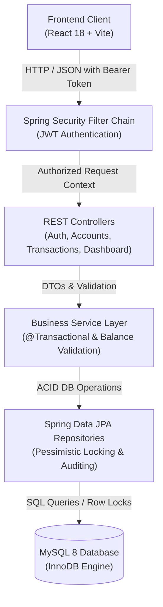
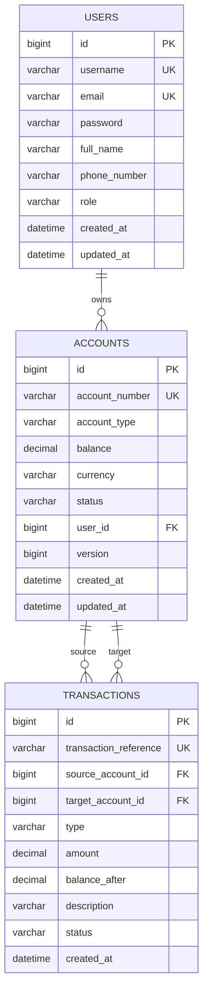

# Online Banking Management System (ApexVault)
## Java Full Stack Internship Capstone Project Report

**Project Title:** ApexVault Online Banking Management System  
**Internship Role:** Java Full Stack Developer Intern  
**Tech Stack:** Java 17, Spring Boot 3.3.x, React 18, Vite, Spring Security, MySQL 8, JPA/Hibernate, JWT  
**Date:** October 2026  

---

## 1. Executive Summary

Modern financial applications require rigorous reliability, strict data consistency, and robust cybersecurity defenses. The **ApexVault Online Banking Management System** is an enterprise-grade full-stack banking prototype built to demonstrate secure software development practices, concurrent transactional operations, and responsive user experiences.

The application allows users to register, securely authenticate using JSON Web Tokens (JWT), maintain multiple bank accounts (Checking, Savings, Business), execute peer-to-peer money transfers with server-enforced atomic balance checks, perform demo deposits and ATM withdrawals, and audit their complete financial history with digital transaction receipts and CSV reporting.

---

## 2. System Architecture

The project employs a decoupled, multi-tier client-server architecture:



### Layer Breakdown:
1. **Presentation Layer (React 18 + Vite)**:
   - High-performance Single Page Application (SPA) utilizing Vite for fast HMR and optimized production bundles.
   - Context API (`AuthContext`) for global authentication state management.
   - Component-driven design with responsive CSS, modal workflows, quick actions, and simulated credit/debit card UI.
2. **Security & API Gateway Layer (Spring Security 6 + JJWT)**:
   - Stateless JWT authentication filter (`AuthTokenFilter`).
   - Standardized authentication entry point (`AuthEntryPointJwt`) delivering JSON error responses.
   - CORS policy configuration for local cross-origin API calls.
3. **Controller Layer (`@RestController`)**:
   - Explicit RESTful endpoint contracts with parameter validation (`@Valid`, `jakarta.validation`).
   - Centralized exception interception via `@RestControllerAdvice` (`GlobalExceptionHandler`).
4. **Service Layer (`@Service`)**:
   - Enforces critical banking business rules: positive balance constraints, self-transfer prevention, atomic source debit and destination credit.
   - Spring transaction isolation management (`@Transactional(isolation = Isolation.REPEATABLE_READ)`).
5. **Persistence Layer (Spring Data JPA / Hibernate / MySQL 8)**:
   - InnoDB storage engine with foreign keys, checks, and unique indexes.
   - Explicit pessimistic row locks (`@Lock(LockModeType.PESSIMISTIC_WRITE)`) to eliminate race conditions during concurrent money transfers.

---

## 3. Entity-Relationship Data Model (ERD)



---

## 4. Key Security Implementations

### 4.1 Cryptographic Password Protection
- Plain-text passwords are never stored in the database.
- Uses **BCrypt** with an adaptive work factor (salt generated cryptographically per user) via Spring Security's `PasswordEncoder`.

### 4.2 Server-Enforced Financial Consistency
- **Never trust client-supplied balances**: The frontend only supplies intent (e.g. transfer \$100 to `ACC-30048123`). The backend independently queries the database, verifies that the source account belongs to the authenticated caller (`userId == account.getUser().getId()`), and verifies that the live stored balance satisfies `balance >= amount`.
- **Atomic Concurrency Protection**: High-frequency financial transfers are vulnerable to race conditions (e.g. double spending). ApexVault implements:
  - Database row locking (`SELECT FOR UPDATE` via `PESSIMISTIC_WRITE`).
  - ID-ordered lock acquisition to eliminate deadlock potential between mutual transfers.
  - ACID rollback: If any step fails during money transfer, all account balances automatically revert to their prior state.

### 4.3 Data Isolation & Authorization
- Users are restricted to querying and operating only accounts linked to their own identity.
- Target recipient lookups only return public identity confirmation (e.g. "Jane Smith - Savings") while keeping balances, IDs, and credentials hidden.

---

## 5. Functional Modules

| Module | Features & Capabilities |
| :--- | :--- |
| **Authentication & Onboarding** | User registration with auto-provisioned primary savings account, BCrypt hashing, JWT issuance, session validation (`/api/auth/me`), and demo quick-login. |
| **Account Management** | Multiple account types (Checking, Savings, Business), balance inquiry, account creation, copyable account numbers, and masked balance toggling. |
| **Transaction Processing** | Inter-account money transfer, demo cash deposits, demo ATM withdrawals, recipient verification, and server balance validation. |
| **Ledger & Audit History** | Paginated transaction ledger, filtering by transaction type (DEPOSIT, WITHDRAWAL, TRANSFER), instant keyword search, and printable digital receipts. |
| **Dashboard Analytics** | Aggregated liquidity summary, active accounts count, total deposits, total withdrawals, recent transactions view, and quick-action triggers. |

---

## 6. Testing & Quality Assurance

Comprehensive automated tests were implemented using **JUnit 5**, **Spring Boot Test**, and **AssertJ**:

```
[INFO] Results:
[INFO] Tests run: 6, Failures: 0, Errors: 0, Skipped: 0
[INFO] BUILD SUCCESS
```

### Verified Test Cases:
1. `contextLoads()`: Verifies application context wiring and dependency injection.
2. `testSuccessfulTransfer()`: Verifies atomic balance debit from source and credit to destination with transaction record creation.
3. `testTransferInsufficientFundsThrowsException()`: Asserts that requests exceeding available balance are rejected with `InsufficientFundsException` without altering balances.
4. `testTransferToSameAccountThrowsException()`: Confirms that transferring to the exact same account is rejected.
5. `testDepositFunds()`: Validates demo cash deposit crediting and transaction persistence.
6. `testWithdrawFunds()`: Validates demo cash withdrawal deducting and balance updates.

---

## 7. Windows Setup & Verification

- **Maven Wrapper**: `mvnw.cmd` automatically bootstraps Apache Maven 3.10.0 without global installation.
- **Node.js**: Frontend builds into optimized static assets via `npm run build`.
- **Startup Automation**: One-click scripts (`start-backend.bat`, `start-frontend.bat`, `start-all.bat`) launch the complete stack on Windows 10/11.

---

## 8. Conclusion

The ApexVault Online Banking Management System demonstrates mastery across the complete Java Full Stack spectrum:
- Architecting robust backend services with Spring Boot and Spring Data JPA.
- Enforcing enterprise security patterns with Spring Security and stateless JWT.
- Designing an intuitive, professional banking user interface in React 18.
- Preventing financial concurrency anomalies with pessimistic database locking and transactional rollback integrity.
